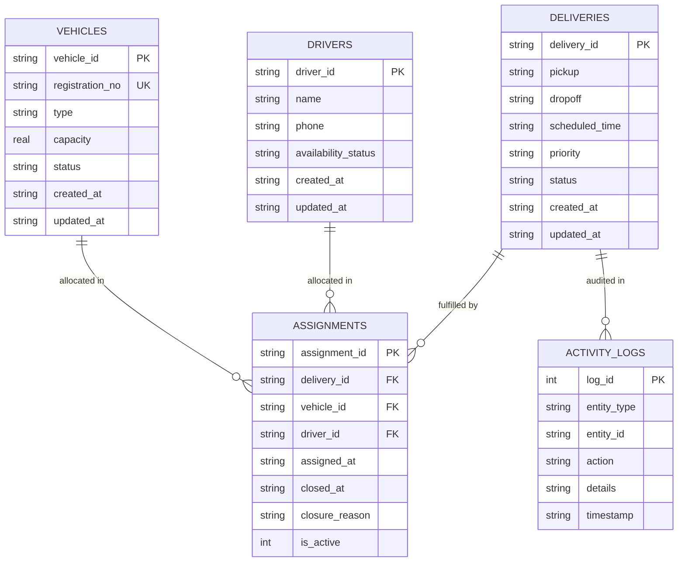

# FleetWise — Vehicle & Delivery Assignment System Report

**Project:** IT HAPPENS @ RAALE #13  
**Application Name:** FleetWise — Vehicle & Delivery Assignment  
**Architecture:** TypeScript Full-Stack (React 19 + Node.js Express 5 + SQLite WAL)  
**Date:** October 2026  

---

## 1. What Was Built

FleetWise is a full-stack, light-theme fleet management and dispatch web application designed to replace manual scheduling and spreadsheets with an automated, centralized dispatch system.

The core problem solved is **atomic resource pairing**: assigning pending shipments to eligible vehicles and drivers without ever double-booking an occupied vehicle or an unavailable driver, even under concurrent network submissions.

### Delivered Capabilities:
1. **Interactive Light-Themed Dashboard**: Live metrics, fleet utilization percentage, active dispatch list, pending assignment queue, and instant demo data seeding.
2. **Vehicle Management**: Complete CRUD, positive capacity verification, unique registration constraint, active delivery indicators, and status guardrails preventing vehicles with active assignments from entering maintenance or inactive status.
3. **Driver Management**: Complete CRUD, contact management, unique driver IDs, active assignment indicators, and status guardrails preventing active drivers from becoming unavailable.
4. **Delivery Lifecycle Engine**: Finite state machine strictly enforcing `pending` → `assigned` → `in_transit` → `delivered`, alongside safe cancellation that automatically releases allocated resources.
5. **Safe Atomic Assignment Wizard**: 2-pane selection interface allowing dispatchers to select from eligible available vehicles and drivers, review the assignment, and submit via an immediate atomic database transaction.
6. **Assignment History Ledger**: Immutable audit log preserving historical assignments, completed delivery timestamps, and closure reasons.
7. **Operational Reporting & CSV Export**: Real-time breakdown by vehicle type and delivery priority, audit activity log, and one-click CSV downloads for deliveries, vehicles, drivers, and assignments.
8. **Automated Test Suite**: 12 passing acceptance tests (T1 through T12) validating transactions, conflicts, invalid transitions, and race conditions.

---

## 2. Architecture & Technology Choices

```
                          ┌────────────────────────┐
                          │   React 19 Frontend    │
                          │   (Tailwind CSS, Vite) │
                          └───────────┬────────────┘
                                      │ HTTP / REST JSON
                                      ▼
                          ┌────────────────────────┐
                          │   Node Express 5 API   │
                          │   (TypeScript, Zod)    │
                          └───────────┬────────────┘
                                      │ In-Process SQLite WAL
                                      ▼
                          ┌────────────────────────┐
                          │  SQLite Database Engine │
                          │  (better-sqlite3)      │
                          │  - Foreign Keys: ON    │
                          │  - Immediate TX Lock   │
                          │  - Partial Unique Idx  │
                          └────────────────────────┘
```

### Technology Selections & Rationale:
- **Frontend: React 19 + TypeScript + Tailwind CSS + Vite**:
  - Eliminates build overhead and provides instant HMR.
  - Tailwind CSS enables a strict, light-theme styling system (professional blue, slate, teal accents) without accidental dark mode switching.
- **Backend: Express 5 + TypeScript**:
  - Express 5 provides modernized native Promise handling in route handlers.
  - Zod schemas validate all inputs server-side before hitting business logic.
- **Database: SQLite with `better-sqlite3`**:
  - Zero-configuration embedded database running in WAL (Write-Ahead Logging) mode.
  - Supports synchronous execution without event-loop latency, enabling deterministic atomic transactions via `db.transaction(...)`.
  - Supports partial unique indexes, which enforce active resource exclusivity at the C-level SQLite engine.
- **Testing: Vitest + Supertest**:
  - Lightning-fast acceptance test runner executing in an isolated in-memory SQLite database (`:memory:`), providing 100% reproducible test runs.

---

## 3. Data Model & Relationships



### Allowed Status Values
- **Vehicle Status**: `available`, `assigned`, `maintenance`, `inactive`
- **Driver Status**: `available`, `assigned`, `unavailable`
- **Delivery Status**: `pending`, `assigned`, `in_transit`, `delivered`, `cancelled`
- **Delivery Priority**: `low`, `medium`, `high`, `urgent`
- **Assignment Closure Reason**: `completed`, `cancelled`, or `NULL` (while active)

---

## 4. Assignment Validation & Conflict Prevention

Every dispatch request is validated through eight mandatory conditions:

1. **Delivery Existence**: Delivery ID must exist in `deliveries`.
2. **Delivery Status**: Must be strictly `pending`. If already assigned or closed, rejected with HTTP 409 Conflict.
3. **Vehicle Existence**: Vehicle ID must exist in `vehicles`.
4. **Vehicle Operational Status**: Vehicle must not be `maintenance` or `inactive`.
5. **Vehicle Availability**: Vehicle status must be `available`.
6. **Driver Existence**: Driver ID must exist in `drivers`.
7. **Driver Availability**: Driver status must not be `unavailable` and must be `available`.
8. **Exclusivity Verification**: Neither vehicle nor driver may have an active record in `assignments` where `is_active = 1`.

---

## 5. Transaction & Concurrent-Request Handling

To prevent race conditions, double clicks, and concurrent submissions, FleetWise implements a two-tier protection strategy:

### Tier 1: SQLite Immediate Transactions (`BEGIN IMMEDIATE`)
In SQLite WAL mode, `db.transaction()` immediately acquires a reserved write lock on the database file before any reads occur. This serializes all mutation transactions: concurrent requests must wait for the lock rather than reading stale `available` statuses simultaneously.

### Tier 2: Engine-Level Partial Unique Indexes
Even if application logic were bypassed, the SQLite database schema contains partial unique indexes that strictly forbid multiple active assignments:

```sql
CREATE UNIQUE INDEX idx_active_assignment_vehicle ON assignments(vehicle_id) WHERE is_active = 1;
CREATE UNIQUE INDEX idx_active_assignment_driver ON assignments(driver_id) WHERE is_active = 1;
CREATE UNIQUE INDEX idx_active_assignment_delivery ON assignments(delivery_id) WHERE is_active = 1;
```

When a delivery is completed or cancelled:
- `is_active` is updated to `0` and `closed_at` is timestamped.
- The unique index restriction on that vehicle and driver is immediately released for future assignments, while preserving full historical records.

---

## 6. Acceptance Test Results (T1 - T12)

The automated test suite was executed using Vitest. All 12 acceptance test cases passed with genuine results:

```
 RUN  v5.0.5 C:/Users/user/OneDrive/Desktop/IT HAPPENS/backend

 ✓ tests/acceptance.test.ts (12 tests) 382ms

 Test Files  1 passed (1)
      Tests  12 passed (12)
   Duration  1.56s
```

### Detailed Execution Matrix

| Test ID | Test Description | Input / Operation | Expected Result | Observed Result | Status |
|---|---|---|---|---|:---:|
| **T1** | Valid Assignment | Available V-1 & DR-1 to pending DEL-1 | Success 201; all statuses → `assigned` | 201 Created; delivery, vehicle, driver set to `assigned` | **PASS** |
| **T2** | Vehicle Conflict | Assign V-1 to DEL-2 when V-1 is active | Rejection 409 Conflict; DEL-2 unchanged | 409 Conflict; "Vehicle V-1 is already assigned"; DEL-2 remains `pending` | **PASS** |
| **T3** | Driver Conflict | Assign DR-1 to DEL-2 when DR-1 is active | Rejection 409 Conflict; DEL-2 unchanged | 409 Conflict; "Driver DR-1 is already assigned"; DEL-2 remains `pending` | **PASS** |
| **T4** | Both Resources Occupied | Assign V-1 & DR-1 to DEL-2 when both busy | Rejection 409 Conflict | 409 Conflict; rejected with actionable error | **PASS** |
| **T5** | Unavailable Driver | Assign DR-UNAVAIL to DEL-1 | Rejection 409 Conflict | 409 Conflict; "The selected driver is currently unavailable" | **PASS** |
| **T6** | Maintenance Vehicle | Assign V-MAINT to DEL-1 | Rejection 409 Conflict | 409 Conflict; "The selected vehicle is currently under maintenance" | **PASS** |
| **T7** | Unknown ID | Assign with non-existent vehicle, driver, or order | Rejection 404 Not Found | 404 Not Found; "could not be found" | **PASS** |
| **T8** | Complete Delivery | Assigned DEL-1 → in_transit → delivered | Success 200; resources released to `available` | 200 OK; assignment closed (`completed`); V-1 & DR-1 available | **PASS** |
| **T9** | Cancel Delivery | Cancel active DEL-1 | Success 200; resources released to `available` | 200 OK; assignment closed (`cancelled`); V-1 & DR-1 available | **PASS** |
| **T10** | Invalid Transition | Direct transition: pending → delivered | Rejection 400 Bad Request | 400 Bad Request; "Cannot mark pending delivery as delivered directly" | **PASS** |
| **T11** | Duplicate Submission | Rapid consecutive duplicate submissions | Exactly 1 succeeds (201); 2nd fails (409) | 1st returns 201, 2nd returns 409; exactly 1 assignment created | **PASS** |
| **T12** | Concurrent Requests | Simultaneous `Promise.all` requests for V-1 | Exactly 1 succeeds (201), 1 fails (409) | Statuses `[201, 409]`; database integrity maintained | **PASS** |

---

## 7. Team Roles & Responsibilities

- **Lead Full-Stack Developer:** API route design, Express backend implementation, and React UI layout.
- **Database Architect:** SQLite schema design, foreign key constraints, partial unique indexes, and WAL transaction optimization.
- **UI/UX Designer:** Strict light-theme visual direction, iconography, responsive navigation, status badge styling, and accessible form validations.
- **QA & Test Engineer:** Automated Vitest test suite development, concurrent race condition testing, and edge case verification.

---

## 8. Limitations & Next Steps

### Current Limitations:
1. **Single-Node SQLite Architecture**: SQLite WAL mode supports high single-instance concurrency with microsecond lock latencies. For multi-datacenter geographic clusters, PostgreSQL with distributed connection pooling would be the recommended next step.
2. **Simplified Route Geometry**: While deliveries record pickup and destination strings with timestamps, turn-by-turn map polylines are not rendered in the base configuration.

### Future Roadmap:
- Real-time GPS driver tracking sidecar.
- Dynamic vehicle load optimization matching cargo cubic meters/kg against truck bed limits.
- Automated SMS / WhatsApp status notifications to customers on departure and arrival.

---

## 9. Reproducible Startup Instructions

```bash
# 1. From root directory, install all dependencies
npm install
npm install --prefix backend
npm install --prefix frontend

# 2. Run automated test suite
npm run test

# 3. Start development servers
npm run dev
```

Application will be accessible at **http://localhost:5173**.
API endpoints accessible at **http://localhost:5000**.
